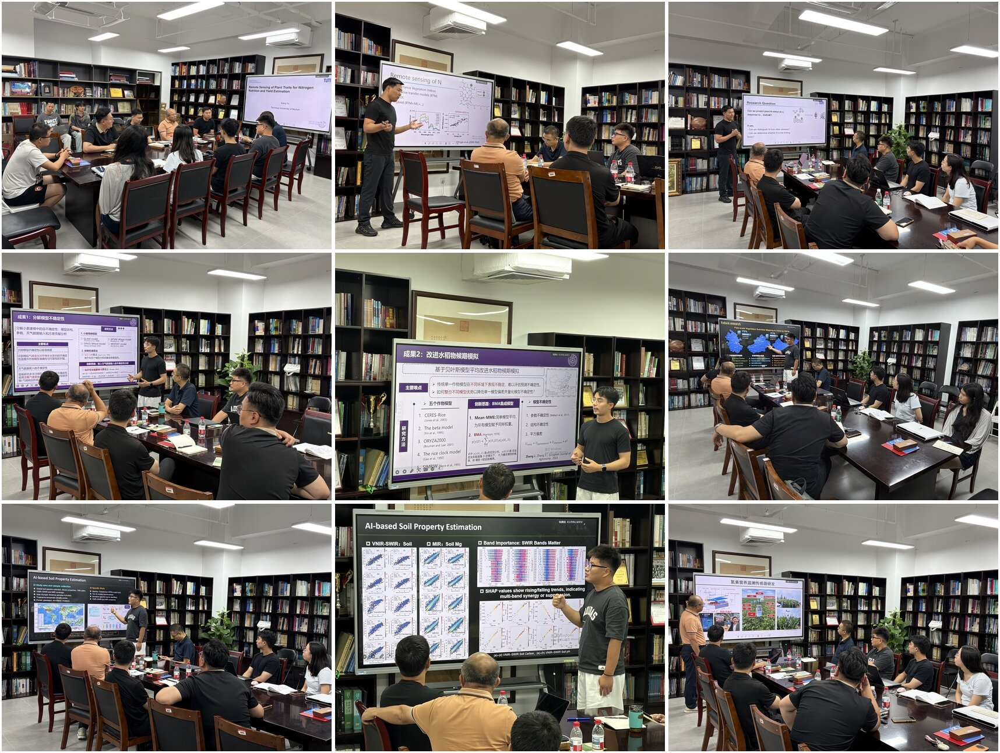
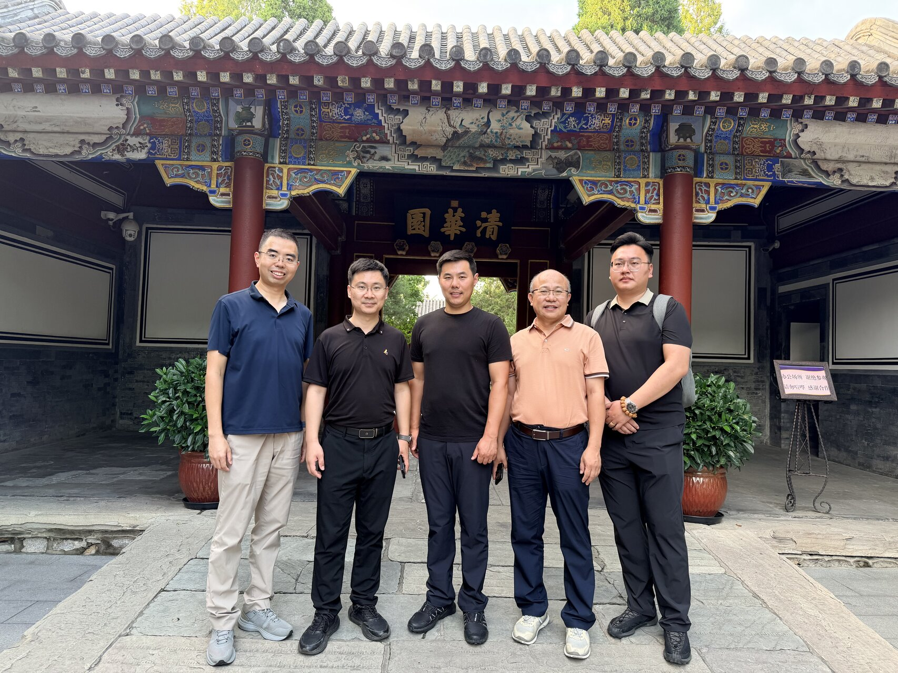
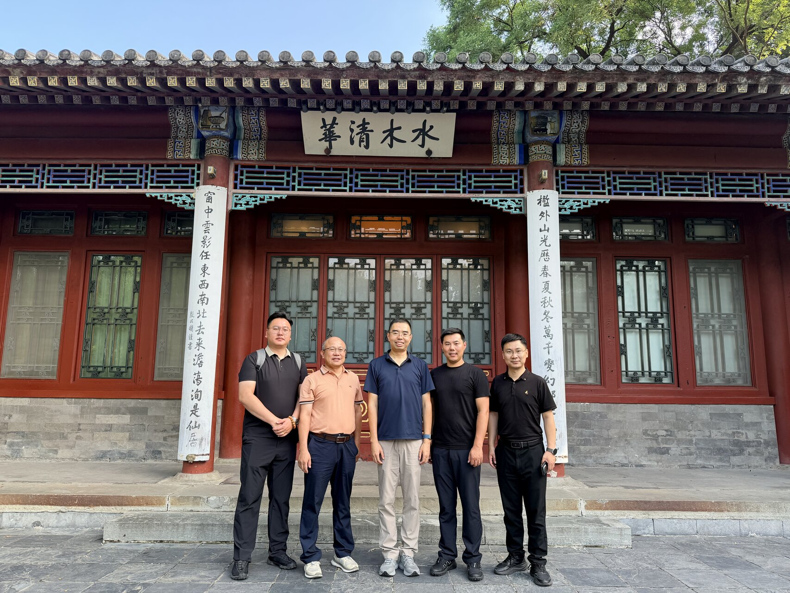

In August 2026, [**Prof. Kang Yu**](/author/prof.-dr.-kang-yu/) spent a week in China on a research visit with **Prof. Le Yu** of the **Department of Earth System Science (DESS) at Tsinghua University**. The visit was part of their **Tsinghua-TUM Seed Fund** project *Satellite-Enabled Crop Monitoring and Biodiversity Assessment for Climate-Resilient Agricultural Systems*, and included joint workshops, field visits, and discussions on the next steps of the collaboration.

## Workshop and field visits in Hohhot

The week began with the **Hohhot** workshop, where both Tsinghua and TUM partners gave talks at a workshop on precision water and nitrogen management hosted by Inner Mongolia Agricultural University, and joined field visits to technology demonstration sites.

## Joint workshop at Tsinghua University

In Beijing, Prof. Le Yu hosted a joint workshop at DESS with researchers and students of the department:

- **Remote Sensing of Plant Traits for Nitrogen Nutrition and Yield Estimation** — Prof. Kang Yu, TUM Precision Agriculture Lab
- **Crop Growth Simulation and Prediction under Extreme Climate Stress** — Jinghui Zheng, Department of Earth System Science, Tsinghua University
- Further talks on **AI-based soil property estimation** and **nitrogen nutrition sensors**

Kang presented the lab's published work on remote sensing of crop nitrogen, water, and yield, from optimized spectral indices ([Yang et al., 2023](/publication/yang-2023-fcr-machine/)) and hybrid models such as DeepSpecN ([Yang et al., 2025](/publication/yang-2025-pp-deepspecn/)) to OPTRAM-ET and satellite-based yield estimation ([Mokhtari et al., 2023](/publication/mokhtari-2023-rse-optramet/); [Mokhtari et al., 2025](/publication/mokhtari-2025-fcr-satellitebased/)) and global chlorophyll and photosynthesis mapping ([Li et al., 2025](/publication/li-2025-rse-global/); [Li et al., 2026](/publication/li-2026-rse-chlorophyllbased/)).

## Discussions and next steps

Beyond the talks, the two groups met to discuss how to combine their expertise in the seed fund project and beyond. The partners agreed to continue the exchange through regular online meetings, student and researcher exchanges, and mutual visits.

## The Tsinghua campus

The visit also offered a walk through Tsinghua's historic campus, from the iconic **Second Gate** to the classical courtyards at the heart of the old **Tsinghua Garden (清华园)**, the former imperial garden on whose grounds the university was founded.

## Thanks

Warm thanks to **Prof. Le Yu** and his group at the **Department of Earth System Science, Tsinghua University**, for their generous hospitality and the inspiring exchange. We gratefully acknowledge the **Tsinghua-TUM Seed Fund** for supporting this collaboration.

*— TUM Precision Agriculture Lab*
