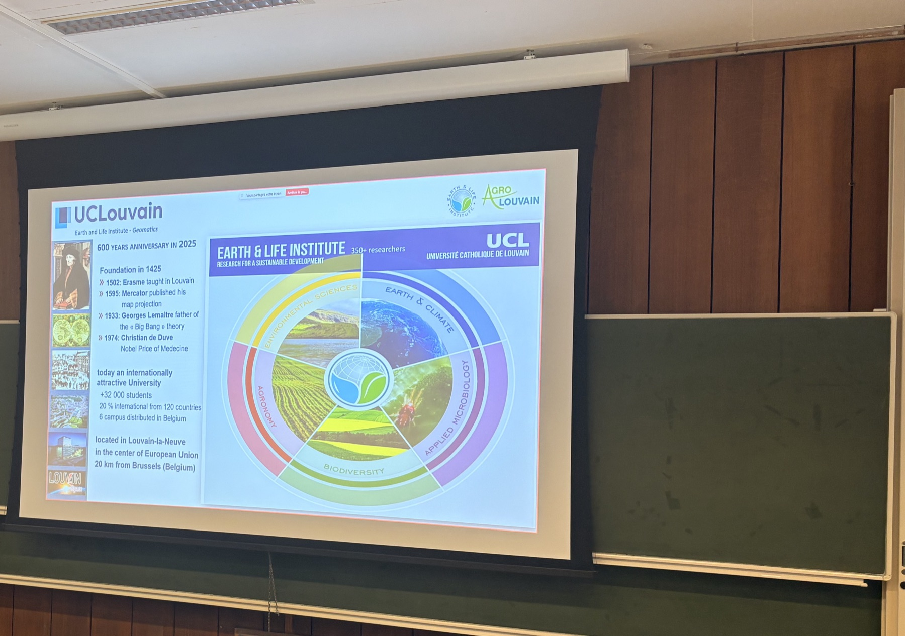
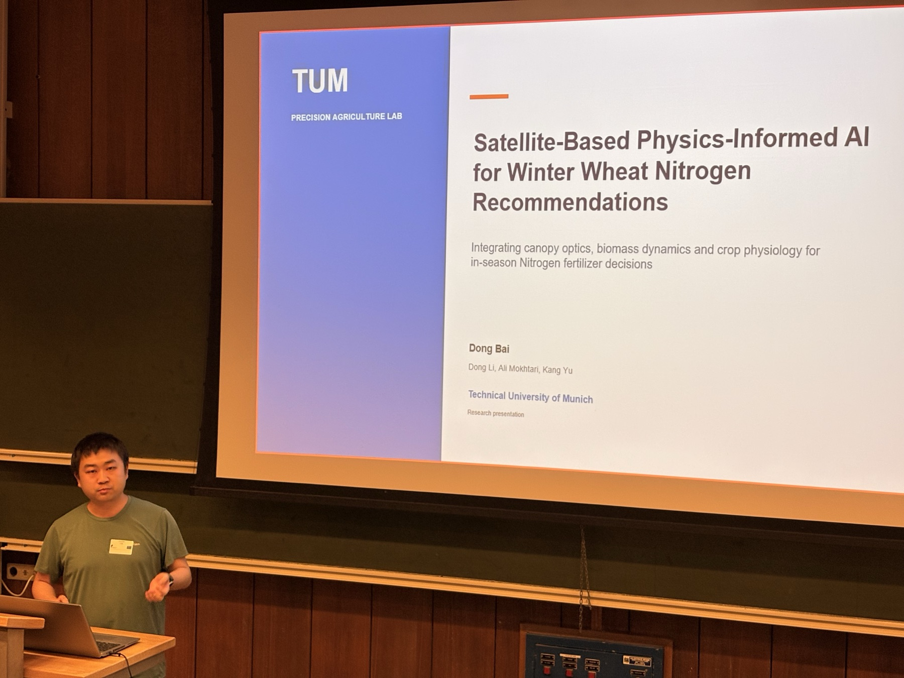
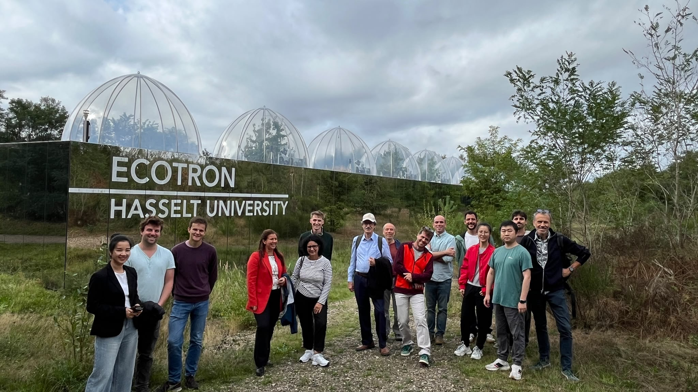

PhD student [**Dong Bai**](/author/dong-bai/) represented the TUM Precision Agriculture Lab at the **PHENET Annual Meeting 2026**, held from **8 to 10 September 2026** in **Louvain-la-Neuve, Belgium**, and hosted by the **Université catholique de Louvain (UCLouvain)**. PHENET (*Phenotyping & Envirotyping Solutions for Agroecology*) brings together 32 beneficiaries across Europe, and the annual meeting is where the partners report on the progress of the past year.

With PHENET entering its final period (the project ends in December 2027), this year's meeting also looked further ahead: how to sustain the project's outcomes and products beyond its lifetime and partnership.

## Dong's talk: physics-informed AI for wheat nitrogen recommendations

Dong presented his PhD work in a talk titled **"Satellite-Based Physics-Informed AI for Winter Wheat Nitrogen Recommendations"**.

The talk addressed a practical question for wheat growers: how much nitrogen does a field need during the season, and where? Dong's approach does not learn nitrogen needs from satellite data alone. It combines satellite observations with three kinds of knowledge about the crop:

- **Canopy optics:** how light interacts with the wheat canopy, linking what the satellite sees to crop traits;
- **Biomass dynamics:** how the crop grows and accumulates biomass through the season;
- **Crop physiology:** how the crop's nitrogen demand follows its growth.

Building this knowledge into the AI model aims to make in-season fertilizer decisions more robust across fields and years than purely data-driven models can. The work continues our lab's [satellite-based nitrogen management research](/post/satellite-farming-boosting-nitrogen-use-efficiency-from-space/) within PHENET, LiveSen-MAP, Greenwindows projects.

## Visiting the Ecotron at Hasselt University

Besides the sessions, Dong joined fellow participants on a visit to the **Ecotron of Hasselt University**, where whole ecosystems are studied under controlled climate conditions in its dome-shaped units.

## Looking ahead

The annual meeting followed the [PHENET workshop at INRAE Montpellier](/post/2026-01-15-phenet-workshop-in-france/) in January, where Dong and Kang discussed interoperable phenotyping pipelines and analysis-ready data. As PHENET moves towards its final year, we look forward to contributing satellite-based workflows for crop nitrogen monitoring that can outlast the project.

## Thanks

Many thanks to our hosts at **UCLouvain** for organizing the meeting and the excursion, and to the **PHENET partners** for three days of open and inspiring exchange.

*— TUM Precision Agriculture Lab*
