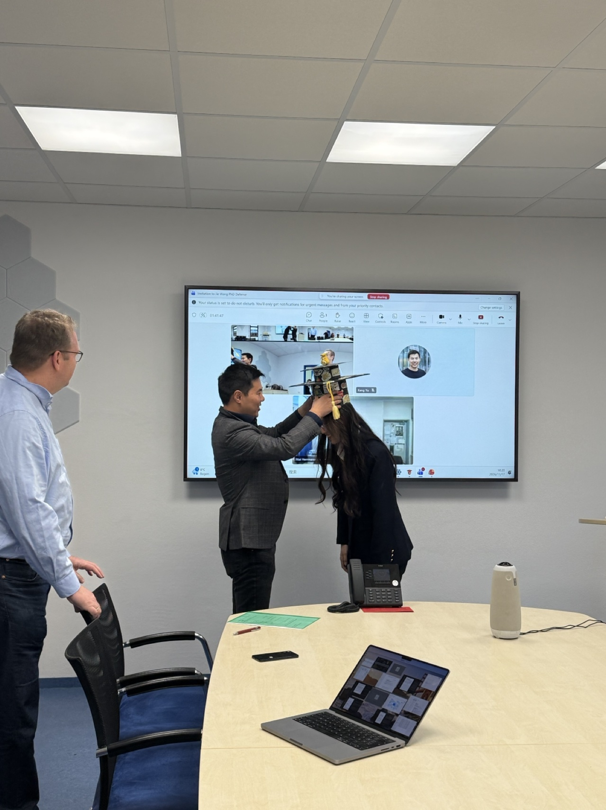

Congratulations to **[Jie Wang](/author/jie-wang/)**, who has just completed her PhD in our **Precision Agriculture Lab at the Technical University of Munich**. Her dissertation, **"Multi-scale Remote Sensing for Sustainable Nitrogen Management in Wheat: From Field Mechanisms to Regional Applications"**, asks a question at the heart of sustainable smart farming: can we see how well a wheat crop grows in response to nitrogen availability and rotation, in a field and over large area?

It is a question that matters. Nitrogen fertilizer drives wheat yields, but it is not the only driving factor, whatever the crop does not take up leads to a cost to both farmers and the environment. Drones and satellites can estimate crop nitrogen status across fields and regions, but only if we understand what their signals really mean. Jie set out to connect the two, from field mechanisms to regional applications.

---

## 🌾 Wheat's nitrogen story, read across scales

Her work delivered a set of well-connected advances:

- Starting in the field, she showed that **drone multispectral imaging captures how soil mineral nitrogen (Nmin) shapes wheat canopy structure**. Low Nmin induces a "blue shift" of the red-edge position, and **nitrogen use efficiency can be predicted already at early growth stages** from red-edge indices and canopy height ([Wang et al., 2025](/publication/wang-2025-cea-drone/), *Computers and Electronics in Agriculture*).
- She then developed **M2H-SWIR**, a framework that couples the PROSAIL-PRO radiative transfer model with deep learning to **reconstruct full 400–2500 nm hyperspectral reflectance from an ordinary multispectral drone camera**, including the nitrogen-sensitive shortwave infrared it never measures, and improves canopy nitrogen estimation ([Wang et al., 2026](/publication/wang-2026-ijaeog-uav/), *Int. J. Appl. Earth Obs. Geoinf.*; see also our [paper story](/post/2026-06-08-from-10-bands-to-over-2000-hyperspectral-from-a-multispectral-drone/)).
- Finally, in the third study, she **scaled these insights from the plot to the region**, using remote sensing to examine how cropping practices and climate shape wheat yield and nitrogen use efficiency across larger areas.

In doing so, Jie's work bridges soil–plant nitrogen processes, drone and satellite remote sensing, and opens new technical viewing angles and insights to precision crop nitrogen management.

---

## 🌟 Congratulations, Dr. Jie Wang!

We are proud of what she achieved! 
We congratulate her warmly and look forward to the impact of her future work.

Most of all, we are proud of the independent scientist Jie has become.

A warm thanks to our team members for their creativity in preparing Jie's doctoral hat — a cherished tradition that made the celebration joyful and memorable.

Congratulations, Jie!

---

## 🌟 Thanks

We would like to thank the examination committee for their time, guidance, and rigorous engagement with her work. My sincere thanks go to **Prof. Ittai Herrmann (The Hebrew University of Jerusalem)** as the co-examiner, and **Prof. Heinz Bernhardt** for chairing the defense. We are also grateful to Jie's collaborators and co-authors, **Prof. Sebastian T. Meyer** and **Prof. Wolfgang W. Weisser** (TUM Terrestrial Ecology), **Prof. Fei Li** (IMAU), and **[Dr. Anirudh Belwalkar](/author/dr.-anirudh-belwalkar/)**, whose input helped shape this research.

Most of all, thank you, Jie, for your dedication and your many contributions to the Precision Agriculture Lab over the years. We wish you all the best in the next chapter.

---

#PhDDefense #RemoteSensing #UAV #Hyperspectral #NitrogenUseEfficiency #Wheat #PrecisionAgriculture #TUM
